# yuwa_raffle_game

เกมจับฉลากสุ่มชื่อสไตล์การ์ตูนเกม (Cartoon Game UI) สำหรับงานของโรงพยาบาลยุวประสาทไวทโยปถัมภ์
มีจอหลักสำหรับฉายขึ้นจอ รีโมตสำหรับทีมงานหลังเวที ปุ่ม VIP ให้ผู้บริหารกดสุ่ม และโหมดออฟไลน์
ติดตั้งเป็นแอปบนมือถือหรือคอมพิวเตอร์ได้ (PWA)

## Overview

### จอหลัก (Main Display)

เวทีสุ่มแบบเกมโชว์ มีไฟกระพริบรอบเวที (กระพริบเร็วขึ้นตอนกำลังสุ่ม) และแสงรัศมีหลังชื่อผู้โชคดี
ด้านซ้ายเป็นรายชื่อผู้เล่น ด้านขวาเป็นรายชื่อผู้โชคดี

| พร้อมสุ่ม | กำลังสุ่ม | ประกาศผล |
|:---:|:---:|:---:|
| 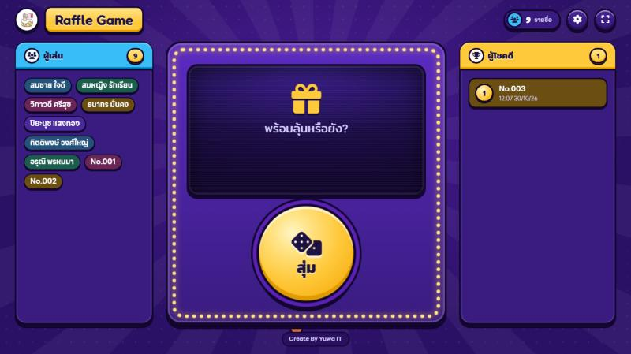 | 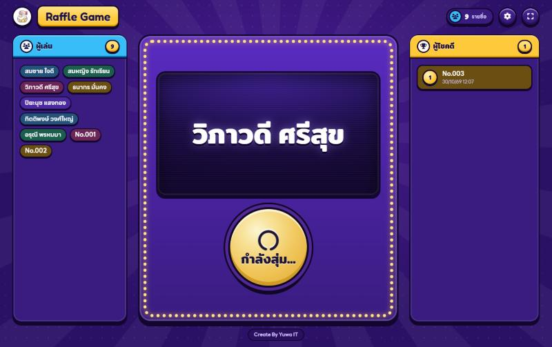 | 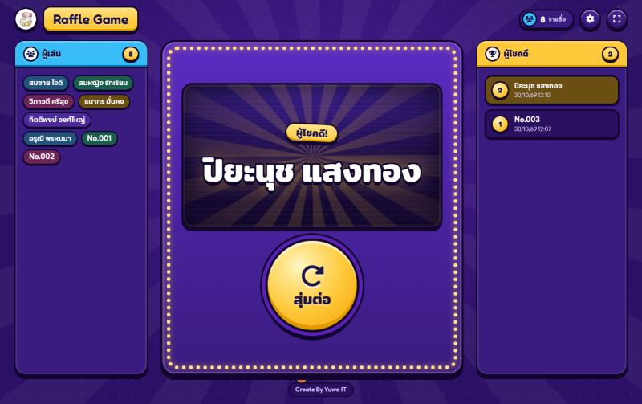 |

### มือถือ

บนจอเล็ก เวทีจะเต็มหน้าจอ ส่วนรายชื่อผู้เล่นและผู้โชคดีย้ายไปอยู่ในปุ่มลอยด้านล่าง กดแล้วเปิดเป็นแผ่นเลื่อนขึ้นจากด้านล่าง

<table>
  <tr>
    <th>จอหลัก</th>
    <th>รายชื่อผู้เล่น</th>
    <th>รีโมตควบคุม</th>
  </tr>
  <tr>
    <td>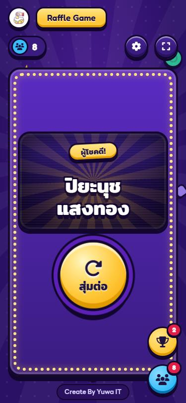</td>
    <td>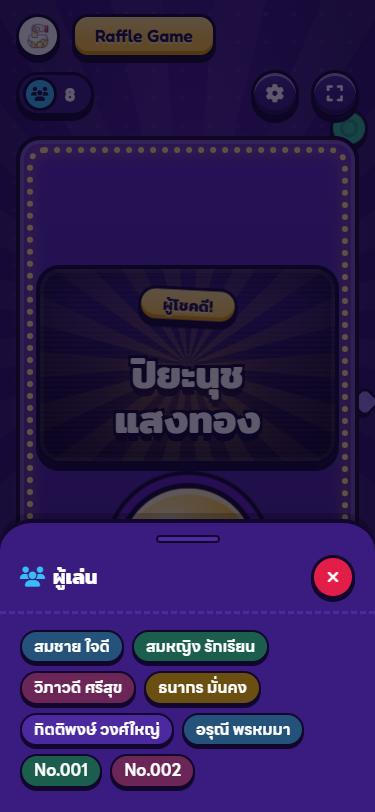</td>
    <td>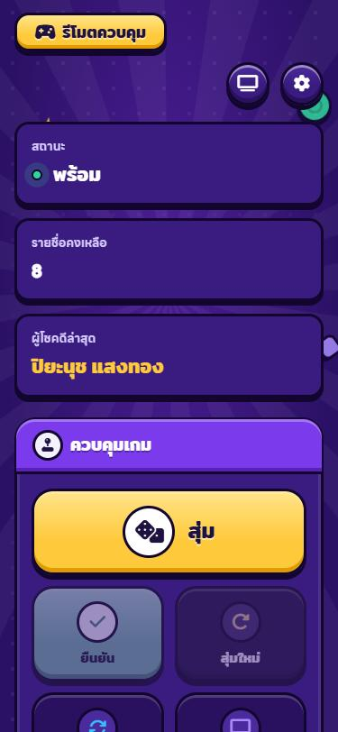</td>
  </tr>
  <tr>
    <th>ปุ่ม VIP</th>
    <th>ปุ่ม VIP — ประกาศผล</th>
    <th>หน้าแรกของแอป (PWA)</th>
  </tr>
  <tr>
    <td>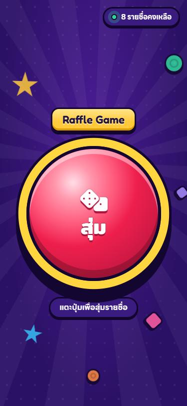</td>
    <td>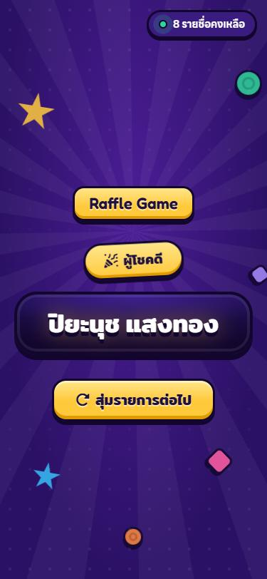</td>
    <td>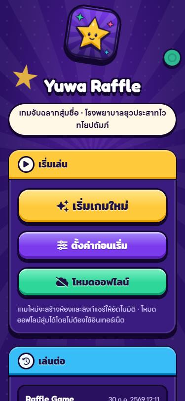</td>
  </tr>
</table>

### ตั้งค่า และโหมดออฟไลน์

| ตั้งค่าเกม | โหมดออฟไลน์ (ธีมกลางวัน) |
|:---:|:---:|
| 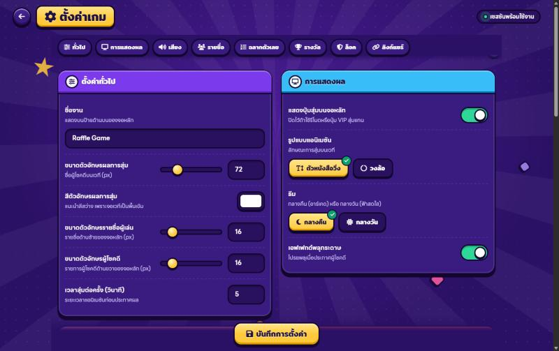 | 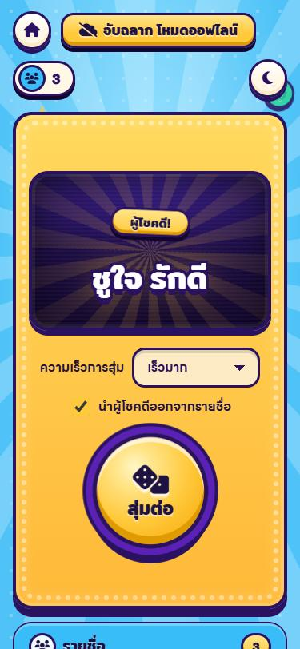 |

### หน้าต่าง ๆ

| หน้า | ไฟล์ | ใช้ทำอะไร |
|---|---|---|
| หน้าแรกของแอป | `start.html` | เริ่มเกมใหม่ เล่นต่อจากเกมล่าสุด หรือเข้าโหมดออฟไลน์ (เป็นหน้าที่เปิดเมื่อติดตั้งเป็นแอป) |
| จอหลัก | `index.php?share=<key>` | หน้าเวทีสำหรับฉายขึ้นจอ (เปิด `index.php` เฉย ๆ จะสร้างเกมใหม่) |
| รีโมตควบคุม | `remote.php?share=<key>` | ทีมงานสั่งสุ่ม ยืนยัน สุ่มใหม่ ยกเลิกผู้โชคดีล่าสุด และลบรายชื่อ |
| ปุ่ม VIP | `button.php?share=<key>` | ปุ่มใหญ่ให้ผู้บริหารกดสุ่มจากมือถือหรือแท็บเล็ต |
| ตั้งค่า | `settings.php?share=<key>` | ชื่องาน รายชื่อ ฉลากตัวเลข ประเภทรางวัล เสียง ธีม และลิงก์ / QR สำหรับแชร์ |
| โหมดออฟไลน์ | `offline/` | สุ่มได้โดยไม่ต้องใช้อินเทอร์เน็ต ข้อมูลเก็บไว้ในเครื่องนั้นเท่านั้น |

### จุดเด่น

- **ธีม 2 แบบ** — กลางคืน (อาร์เคด) และกลางวัน (ฟ้าสดใส) เลือกได้ในหน้าตั้งค่า
- **แอนิเมชันการสุ่ม 2 แบบ** — ตัวหนังสือวิ่ง หรือวงล้อ
- **ซิงก์ทุกหน้าแบบเรียลไทม์** — กดสุ่มจากรีโมตหรือปุ่ม VIP แล้วจอหลักเล่นตาม
- **PWA** — ติดตั้งเป็นแอปได้ มีหน้าแจ้งเมื่อไม่มีอินเทอร์เน็ต และแจ้งเตือนเมื่อมีเวอร์ชันใหม่
- **รองรับทุกขนาดจอ** — ตั้งแต่มือถือ 375px ไปจนถึงจอโปรเจกเตอร์
- **เข้าถึงง่าย** — ใช้คีย์บอร์ดได้ มีกรอบโฟกัสชัดเจน และลดแอนิเมชันอัตโนมัติเมื่อเครื่องตั้งค่าไว้

รายละเอียดสี ฟอนต์ และคอมโพเนนต์อยู่ที่ [design-system/yuwa-raffle/MASTER.md](design-system/yuwa-raffle/MASTER.md)

---

## Installation

run command
```bash
$ composer install
```

# Files Create
### Configs
create file `.env`
```.env
# Database Parameters
DB_HOSTNAME=
DB_USERNAME=
DB_PASSWORD=
DB_DATABASE=
```

## PWA notes

- Service worker (`sw.js`) ทำงานได้เฉพาะบน `https` หรือ `localhost` เท่านั้น
- ทุกครั้งที่ deploy ให้เปลี่ยนค่า `VERSION` ใน `sw.js` เพื่อให้ผู้ใช้ได้รับเวอร์ชันใหม่
- ถ้า server เป็น nginx ให้ตั้ง header `Cache-Control: no-cache` ให้ `sw.js` (ไฟล์ `.htaccess` ใช้ได้เฉพาะ Apache)
